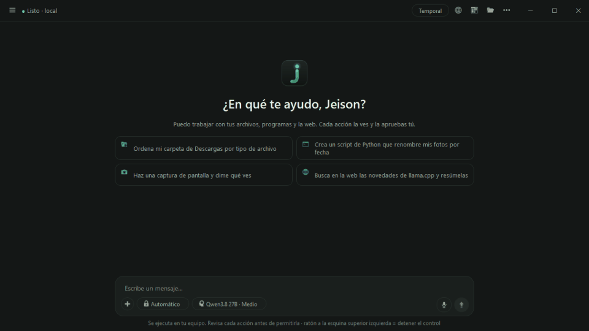
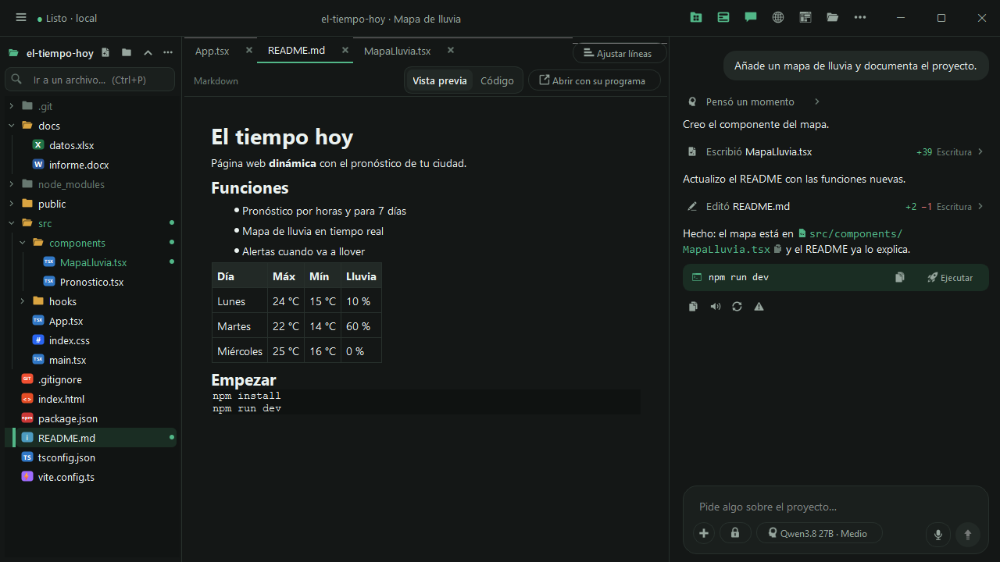
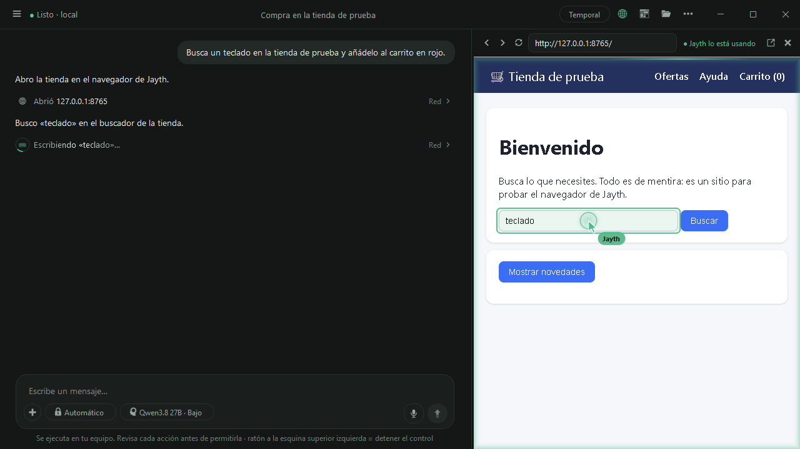

<h1 align="center">
  <picture>
    <source media="(prefers-color-scheme: dark)" srcset="docs/img/logotipo-fondo-oscuro.svg">
    
  </picture>
</h1>

A desktop app for **Windows, macOS and Linux** that turns **any local AI model** (GGUF format) into an agent that writes
code, creates files, runs commands and programs, uses the web and controls your computer. Everything happens on your
machine and **you approve every action**.

Created by **Ing. Jeison Tuiran** · Free software under the [GPL-3.0](LICENSE) license · [Trademark policy](MARCA.md) (in Spanish)

[Español](README.md) · **English**

> **Note:** Jayth's interface is currently in **Spanish**. The agent answers in the language you write to it, so you can
> talk to it in English. An English interface is planned.

<p align="center"></p>

## ⬇️ Download

| System | Direct download (latest version) |
|---|---|
| **Windows 10/11** (64-bit) | **[Installer (.exe)](https://github.com/Json-Tuiran/jayth.ai/releases/latest/download/Jayth-Setup-x64.exe)** · [Portable (.zip)](https://github.com/Json-Tuiran/jayth.ai/releases/latest/download/Jayth-windows-x64-portable.zip) |
| **macOS** with Apple chip (M1–M4) | **[Jayth for Apple Silicon (.dmg)](https://github.com/Json-Tuiran/jayth.ai/releases/latest/download/Jayth-macos-arm64.dmg)** |
| **macOS** with Intel | **[Jayth for Intel (.dmg)](https://github.com/Json-Tuiran/jayth.ai/releases/latest/download/Jayth-macos-x64.dmg)** |
| **Linux** (x86_64) | **[AppImage](https://github.com/Json-Tuiran/jayth.ai/releases/latest/download/Jayth-linux-x86_64.AppImage)** · [Archive (.tar.gz)](https://github.com/Json-Tuiran/jayth.ai/releases/latest/download/Jayth-linux-x86_64.tar.gz) |

Each link downloads the latest version for that system. All versions and their notes are on
**[Releases](https://github.com/Json-Tuiran/jayth.ai/releases)**. Instructions in [Download and install](#download-and-install).
[Code signing policy](CODE_SIGNING_POLICY.md#english-summary) · [Privacy](CODE_SIGNING_POLICY.md#english-summary)

## What it does

- **You see how it works:** the agent tells you what it is about to do, every action shows up with its icon and an
  animation while it runs, its reasoning unfolds with one click, and the screenshots it uses to check its work appear in the chat.
- **Uses your programs and the web:** it reads the buttons and fields of any program (system accessibility APIs), clicks,
  drags, types and manages windows; it has a **built-in browser** it uses in plain sight (search, click, fill in forms),
  with its own pointer and a glow around the edges while it is in control.
- **Any model:** download GGUF models from Hugging Face inside the app (it lists the quantizations and marks which ones
  fit your machine), use a `.gguf` you already have, or connect to an OpenAI-compatible server (Ollama, LM Studio, another PC).
- **Adapts to your hardware:** detects RAM, CPU and GPU; downloads the right official llama.cpp build (Metal on Apple
  Silicon Macs, CUDA for NVIDIA, Vulkan for AMD/Intel Arc, or CPU) and recommends a quantization.
- **No cloud:** once the model is downloaded it works offline. Web tools are only used when there is a connection.
- **Full control:** permission modes, Allow/Deny buttons for each action, a Stop button and a mouse failsafe.
- **Two modes:** Chat for any task and **Jayth Code** for projects (file tree, editor, terminal and agent).
- **Your own layout:** drag the dividers to resize each panel; double-click a divider to fold it. In Code you can hide
  the explorer (Ctrl+B), the terminal (Ctrl+\`) or the agent (Ctrl+L), move the agent left or right, put the terminal
  below or beside the editor and use focus mode (Ctrl+Shift+M). Everything is remembered.
- **Clear downloads:** percentage, size, speed, time left and elapsed, per file and in total; they resume where they
  stopped and are verified with SHA-256.
- **A harness built to get the most out of every model, even local ones:**
  - visible task list (`update_plan`), questions with options (`ask_user`) and **Plan** mode (it proposes, you approve, it executes);
  - reads the project's `AGENTS.md` / `JAYTH.md` / `CLAUDE.md`, knows its structure and remembers your preferences (memory);
  - precise, tolerant edits (`edit_file`, `multi_edit`), move and trash, background commands, Word/Excel/PowerPoint/PDF and images;
  - **Undo** any file change (per action or for a whole answer);
  - repairs malformed JSON, stops repeated actions, summarizes the context when it fills up and counts real tokens;
  - recommended sampling per model family (Qwen, Gemma, Llama, Mistral, DeepSeek…) and cache warm-up;
  - **MCP connectors** (Model Context Protocol) to add external tools.
- **Always up to date:** tells you about new Jayth versions (one-click update) and new versions of your models.
- **Feedback:** report bugs or suggest improvements from the app; you review the text before it is sent.

## Screenshots

**Jayth Code:** explorer with file-type icons, previews for Markdown, Word, Excel, PowerPoint, PDF and images, and the
agent working on your project (the files it changes are marked in green).

<p align="center"></p>

**Built-in browser:** the agent opens websites, searches, clicks and fills in forms in plain sight; you can step in at any time.

<p align="center"></p>

## Download and install

Nothing else to install: no Python, no dependencies.

| System | Download | How |
|---|---|---|
| Windows 10/11 (64-bit) | [Jayth-Setup-x64.exe](https://github.com/Json-Tuiran/jayth.ai/releases/latest/download/Jayth-Setup-x64.exe) | Open it and follow the wizard. It installs for your user, no admin rights needed. |
| Windows, no install | [Jayth-windows-x64-portable.zip](https://github.com/Json-Tuiran/jayth.ai/releases/latest/download/Jayth-windows-x64-portable.zip) | Unzip and open `Jayth.exe`. Data is stored next to the program (great for a USB drive). |
| macOS Apple Silicon (M1–M4) | [Jayth-macos-arm64.dmg](https://github.com/Json-Tuiran/jayth.ai/releases/latest/download/Jayth-macos-arm64.dmg) | Open the `.dmg` and drag Jayth to Applications. |
| macOS Intel | [Jayth-macos-x64.dmg](https://github.com/Json-Tuiran/jayth.ai/releases/latest/download/Jayth-macos-x64.dmg) | Same as above. |
| Linux x86_64 | [Jayth-linux-x86_64.AppImage](https://github.com/Json-Tuiran/jayth.ai/releases/latest/download/Jayth-linux-x86_64.AppImage) | `chmod +x Jayth-*.AppImage` and open it. There is also a [`.tar.gz`](https://github.com/Json-Tuiran/jayth.ai/releases/latest/download/Jayth-linux-x86_64.tar.gz). |

Not sure whether your Mac is Apple Silicon or Intel? Apple menu → *About This Mac*: if it says «Chip Apple M…» it is Apple Silicon.

On first launch, a **setup wizard** detects your hardware, downloads the engine and the model (resumable, verified with
SHA-256) and configures everything.

> The packages are not signed yet. **Windows:** if «Windows protected your PC» appears, click *More info → Run anyway*.
> **macOS:** the first time, right-click Jayth → *Open* (or *System Settings → Privacy & Security → Open Anyway*).

### From source (for development)

With Python 3.10+:

```bash
git clone https://github.com/Json-Tuiran/jayth.ai.git
cd jayth.ai
python -m venv .venv
# Windows: .venv\Scripts\activate     macOS/Linux: source .venv/bin/activate
pip install -r requirements.txt
python app.py
```

On Windows you can also use the installer from source (PowerShell, no admin rights):

```powershell
irm https://raw.githubusercontent.com/Json-Tuiran/jayth.ai/main/install.ps1 | iex
```

## Usage

| Part | What for |
|---|---|
| Conversations (left panel) | Saved history; right-click to rename or delete |
| Model | Start/stop the engine; **Modelos…** to add, switch or delete models |
| Permissions | Read only · Plan · Ask (default) · Edit files · Automatic |
| Chat | The agent says what it is doing; each action is a line with its icon that unfolds to show the exact command or change and its result |
| Jayth browser (globe button) | Websites the agent uses in plain sight: search, click, fill in forms (you type passwords yourself) |

**Permission modes:** sensitive actions (deleting, installing, `sudo`, touching the system or protected paths) **always**
ask for confirmation, even in Automatic mode. To stop mouse control instantly, move the pointer to the top-left corner of the screen.

## Agent tools

Files (read, write, edit, move, trash, search) · system terminal (PowerShell on Windows, zsh/bash on macOS and Linux)
and background processes · open programs/files/URLs · documents and images · web (search, read pages, download) and the
built-in browser · computer control (screenshots of the screen or a window, reading any program's buttons and fields
through accessibility, click, drag, keyboard, windows, clipboard) · MCP connectors.

Web search uses DuckDuckGo. If it asks for a captcha, the app does not bypass it and falls back to Wikipedia. For full
web search, add a Brave Search key or your own SearXNG instance in Settings.

**Computer control outside Windows:**
- **macOS:** give Jayth *Screen Recording* and *Accessibility* in *System Settings → Privacy & Security*.
- **Linux:** works in X11 sessions. On Wayland, global mouse and keyboard control is limited by design (choose «Ubuntu on
  Xorg» at login). To list and focus windows install `wmctrl` (`sudo apt install wmctrl`).

## Where everything is stored

| What | Windows | macOS | Linux |
|---|---|---|---|
| Settings, conversations, engine and models | `%LOCALAPPDATA%\Jayth` | `~/Library/Application Support/Jayth` | `~/.local/share/jayth` |
| Agent working folder | `Documents\Jayth` | `~/Documents/Jayth` | `~/Documentos/Jayth` (or `~/Documents`) |

The models folder and the working folder can be changed in Settings. **Portable mode:** a `portable.txt` file next to
the program stores everything in `userdata/` beside it.

## Uninstall

- **Windows:** *Settings → Apps → Jayth → Uninstall* (or `uninstall.ps1` if you installed from source).
- **macOS:** drag Jayth to the Trash.
- **Linux:** delete the `.AppImage`.

Your data and models are not deleted when uninstalling; they are in the folders listed above.

## Requirements

Windows 10/11 (64-bit), macOS 11 or later, or a 64-bit Linux distribution with glibc 2.35+ (Ubuntu 22.04, Debian 12,
Fedora 36 or later). The memory you need depends on the model: the wizard shows which quantizations fit. With an NVIDIA
GPU the model is split automatically between VRAM and RAM; on Apple Silicon Macs it uses unified memory with Metal.

## License and authorship

**Jayth** was created by **Ing. Jeison Tuiran**, who holds the copyright (Copyright (C) 2026 Ing. Jeison Tuiran).

It is free software under the **[GNU GPL-3.0](LICENSE)** license:
- **You can** use it for free for anything, study the code, modify it and share it.
- **If you share a modified version**, it must remain free: with its source code, under the same GPL-3.0 license and
  keeping the copyright notice. Jayth, or any part of it, cannot be turned into closed-source software.
- **The name «Jayth», its logo and icons** are the project's trademark: a modified version must use a different name and
  logo and cannot be presented as official. Details in the [trademark policy](MARCA.md) (in Spanish).

Contributions to the repository are accepted under the same GPL-3.0 license.

**[Code signing policy](CODE_SIGNING_POLICY.md#english-summary):** free code signing provided by
[SignPath.io](https://about.signpath.io/), certificate by [SignPath Foundation](https://signpath.org/). Windows packages
will be signed with SignPath, after manual approval by the author, once signing is enabled; until then they are
published unsigned.
