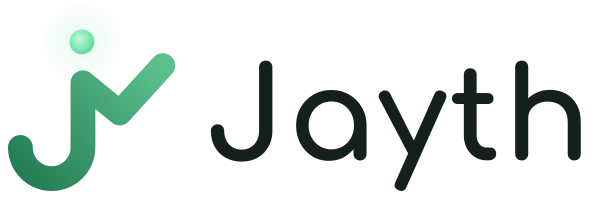
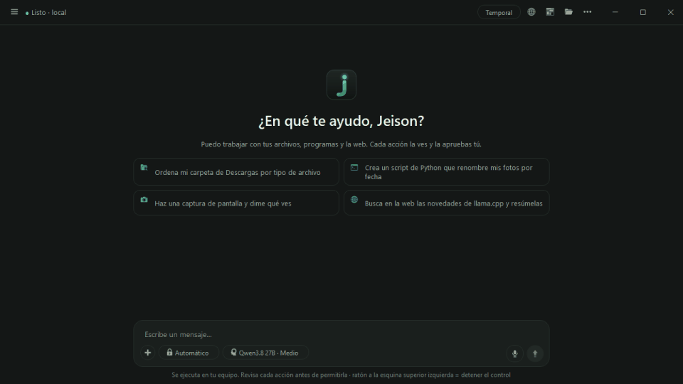
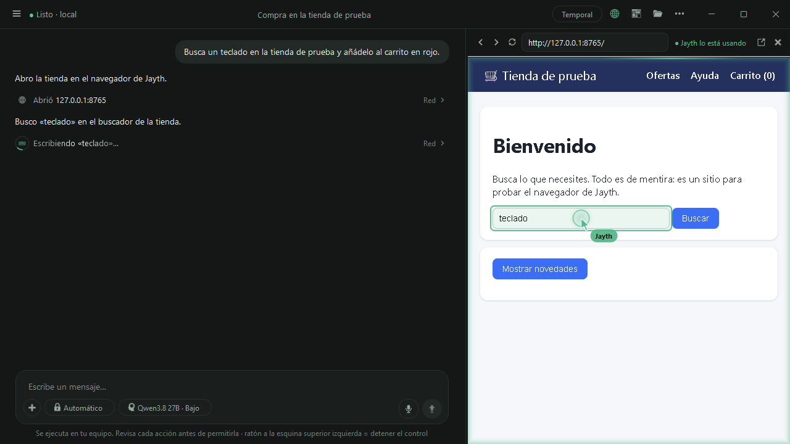

<h1 align="center">
  <picture>
    <source media="(prefers-color-scheme: dark)" srcset="docs/img/logotipo-fondo-oscuro.svg">
    
  </picture>
</h1>

Aplicación de escritorio para **Windows, macOS y Linux** que convierte **cualquier modelo de IA local** (formato GGUF) en un
agente que programa, crea archivos, ejecuta comandos y programas, usa la web y controla el ordenador. Todo ocurre en tu
equipo y **tú apruebas cada acción**.

Creado por **Ing. Jeison Tuiran** · Software libre con licencia [GPL-3.0](LICENSE) · [Política de marca](MARCA.md)

**Español** · [English](README.en.md)

<p align="center"></p>

## ⬇️ Descargar

| Sistema | Descarga directa (última versión) |
|---|---|
| **Windows 10/11** (64 bits) | **[Instalador (.exe)](https://github.com/Json-Tuiran/jayth.ai/releases/latest/download/Jayth-Setup-x64.exe)** · [Versión portátil (.zip)](https://github.com/Json-Tuiran/jayth.ai/releases/latest/download/Jayth-windows-x64-portable.zip) |
| **macOS** con chip Apple (M1–M4) | **[Jayth para Apple Silicon (.dmg)](https://github.com/Json-Tuiran/jayth.ai/releases/latest/download/Jayth-macos-arm64.dmg)** |
| **macOS** con Intel | **[Jayth para Intel (.dmg)](https://github.com/Json-Tuiran/jayth.ai/releases/latest/download/Jayth-macos-x64.dmg)** |
| **Linux** (x86_64) | **[AppImage](https://github.com/Json-Tuiran/jayth.ai/releases/latest/download/Jayth-linux-x86_64.AppImage)** · [Comprimido (.tar.gz)](https://github.com/Json-Tuiran/jayth.ai/releases/latest/download/Jayth-linux-x86_64.tar.gz) |

Cada enlace baja directamente la última versión para ese sistema. Todas las versiones y sus notas están en
**[Releases](https://github.com/Json-Tuiran/jayth.ai/releases)**. Instrucciones en [Descargar e instalar](#descargar-e-instalar).
[Code signing policy](CODE_SIGNING_POLICY.md) · [Privacidad](CODE_SIGNING_POLICY.md#privacidad)

## Qué hace

- **Ves cómo trabaja:** el agente cuenta lo que va a hacer, cada acción aparece con su icono y una animación mientras se
  ejecuta, su razonamiento se despliega con un clic y las capturas de lo que comprueba se ven en el chat.
- **Usa tus programas y la web:** lee los botones y campos de cualquier programa (accesibilidad del sistema), hace clic,
  arrastra, escribe y maneja ventanas; tiene un **navegador integrado** que usa a la vista (buscar, pulsar, rellenar
  formularios), con su propio puntero y un brillo en los bordes mientras tiene el control.
- **Cualquier modelo:** descarga GGUF de Hugging Face desde la propia app (lista las cuantizaciones y marca cuáles caben
  en tu equipo), usa un `.gguf` que ya tengas, o conéctate a un servidor compatible con OpenAI (Ollama, LM Studio, otro PC).
- **Se adapta al hardware:** detecta RAM, CPU y GPU; descarga la compilación oficial de llama.cpp adecuada
  (Metal en Mac con Apple Silicon, CUDA para NVIDIA, Vulkan para AMD/Intel Arc, o CPU) y recomienda la cuantización.
- **Sin nube:** después de descargar el modelo funciona sin internet. Las herramientas web solo se usan si hay conexión.
- **Control total:** modos de permiso, botones Permitir/Denegar por acción, botón Detener y failsafe del ratón.
- **Dos modos:** Chat para cualquier tarea y **Jayth Code** para proyectos (árbol de archivos, editor, terminal y agente).
- **Distribución a tu gusto:** arrastra los divisores para cambiar el ancho de cada panel; doble clic en un divisor lo
  pliega. En Code puedes ocultar el explorador (Ctrl+B), la terminal (Ctrl+\`) o el agente (Ctrl+L), mover el agente a la
  izquierda o a la derecha, poner la terminal debajo o al lado del editor y usar el modo enfoque (Ctrl+Shift+M).
  Las secciones y grupos del historial se pliegan. Todo se recuerda al volver a abrir.
- **Descargas claras:** porcentaje, tamaño descargado, velocidad, tiempo restante y transcurrido, por archivo y en total;
  se reanudan donde se quedaron y se verifican con SHA-256.
- **Un arnés pensado para sacar lo máximo de cada modelo, incluso local:**
  - lista de tareas visible (`update_plan`), preguntas con opciones (`ask_user`) y modo **Planificar** (propone, tú apruebas, ejecuta);
  - lee `AGENTS.md` / `JAYTH.md` / `CLAUDE.md` del proyecto, conoce su estructura y recuerda tus preferencias (memoria);
  - ediciones precisas y tolerantes (`edit_file`, `multi_edit`), mover y papelera, comandos en segundo plano, Word/Excel/PowerPoint/PDF e imágenes;
  - **Deshacer** cualquier cambio de archivos (por acción o por respuesta completa);
  - repara JSON mal formado, frena acciones repetidas, resume el contexto al llenarse y cuenta los tokens reales;
  - muestreo recomendado por familia de modelo (Qwen, Gemma, Llama, Mistral, DeepSeek…) y precalentamiento de la caché;
  - **conectores MCP** (Model Context Protocol) para añadir herramientas externas.
- **Siempre al día:** avisa de versiones nuevas de Jayth (y se actualiza sola con un clic) y de versiones nuevas de tus modelos.
- **Comentarios:** informa de errores o sugiere mejoras desde la app; revisas el texto antes de enviarlo.

## Así se ve

**Jayth Code:** explorador con iconos por tipo, vista previa de Markdown, Word, Excel, PowerPoint, PDF e imágenes, y
el agente trabajando en tu proyecto (los archivos que cambia quedan marcados en verde).

<p align="center"></p>

**Navegador integrado:** el agente abre webs, busca, pulsa y rellena formularios a la vista; tú puedes intervenir cuando quieras.

<p align="center"></p>

## Descargar e instalar

No hace falta instalar Python ni nada más.

| Sistema | Descarga | Cómo |
|---|---|---|
| Windows 10/11 (64 bits) | [Jayth-Setup-x64.exe](https://github.com/Json-Tuiran/jayth.ai/releases/latest/download/Jayth-Setup-x64.exe) | Ábrelo y sigue el asistente. Se instala para tu usuario, sin permisos de administrador. |
| Windows, sin instalar | [Jayth-windows-x64-portable.zip](https://github.com/Json-Tuiran/jayth.ai/releases/latest/download/Jayth-windows-x64-portable.zip) | Descomprime y abre `Jayth.exe`. Guarda los datos junto al programa (ideal para un USB). |
| macOS Apple Silicon (M1–M4) | [Jayth-macos-arm64.dmg](https://github.com/Json-Tuiran/jayth.ai/releases/latest/download/Jayth-macos-arm64.dmg) | Abre el `.dmg` y arrastra Jayth a Aplicaciones. |
| macOS Intel | [Jayth-macos-x64.dmg](https://github.com/Json-Tuiran/jayth.ai/releases/latest/download/Jayth-macos-x64.dmg) | Igual que el anterior. |
| Linux x86_64 | [Jayth-linux-x86_64.AppImage](https://github.com/Json-Tuiran/jayth.ai/releases/latest/download/Jayth-linux-x86_64.AppImage) | `chmod +x Jayth-*.AppImage` y ábrelo. También hay un [`.tar.gz`](https://github.com/Json-Tuiran/jayth.ai/releases/latest/download/Jayth-linux-x86_64.tar.gz). |

¿No sabes si tu Mac es Apple Silicon o Intel? Menú Apple → *Acerca de este Mac*: si pone «Chip Apple M…» es Apple Silicon.

En el primer arranque, un **asistente** detecta tu hardware, descarga el motor y el modelo (con reanudación y
verificación SHA-256) y deja todo configurado.

> Los paquetes aún no están firmados. **Windows:** si aparece «Windows protegió su PC», pulsa *Más información →
> Ejecutar de todas formas*. **macOS:** la primera vez, clic derecho sobre Jayth → *Abrir* (o *Ajustes del Sistema →
> Privacidad y seguridad → Abrir igualmente*).

### Desde el código (para desarrollar)

Con Python 3.10+:

```bash
git clone https://github.com/Json-Tuiran/jayth.ai.git
cd jayth.ai
python -m venv .venv
# Windows: .venv\Scripts\activate     macOS/Linux: source .venv/bin/activate
pip install -r requirements.txt
python app.py
```

En Windows también puedes usar el instalador desde el código (PowerShell, sin permisos de administrador):

```powershell
irm https://raw.githubusercontent.com/Json-Tuiran/jayth.ai/main/install.ps1 | iex
```

## Uso

| Parte | Para qué |
|---|---|
| Conversaciones (panel izquierdo) | Historial guardado; clic derecho para renombrar o borrar |
| Modelo | Encender/apagar el motor; **Modelos…** para añadir, cambiar o borrar modelos |
| Permisos | Solo lectura · Planificar · Preguntar (por defecto) · Editar archivos · Automático |
| Chat | El agente cuenta lo que va haciendo; cada acción es una línea con su icono que se despliega para ver el comando o el cambio exacto y su resultado |
| Navegador de Jayth (botón del globo) | Webs que el agente usa a la vista: buscar, pulsar, rellenar formularios (las contraseñas las escribes tú) |

**Modos de permiso:** las acciones delicadas (borrar, instalar, `sudo`, tocar el sistema o rutas protegidas) **siempre**
piden confirmación, incluso en modo Automático. Para abortar el control del ratón al instante, lleva el cursor a la esquina
superior izquierda de la pantalla.

## Herramientas del agente

Archivos (leer, escribir, editar, mover, papelera, buscar) · terminal del sistema (PowerShell en Windows, zsh/bash en
macOS y Linux) y procesos en segundo plano · abrir programas/archivos/URLs · documentos e imágenes · web (buscar, leer
páginas, descargar) y navegador integrado · control del PC (capturas de la pantalla o de una ventana, leer los botones y
campos de cualquier programa por accesibilidad, clic, arrastrar, teclado, ventanas, portapapeles) · conectores MCP.

La búsqueda web usa DuckDuckGo. Si este pide un captcha, la app no lo salta y cae a Wikipedia. Para una búsqueda web
completa añade una clave de Brave Search o tu propio SearXNG en Ajustes.

**Control del PC fuera de Windows:**
- **macOS:** concede a Jayth *Grabación de pantalla* y *Accesibilidad* en *Ajustes del Sistema → Privacidad y seguridad*.
- **Linux:** funciona en sesiones X11. En Wayland el control global del ratón y el teclado está limitado por diseño
  (elige «Ubuntu on Xorg» al iniciar sesión). Para listar y enfocar ventanas instala `wmctrl` (`sudo apt install wmctrl`).

## Dónde se guarda todo

| Qué | Windows | macOS | Linux |
|---|---|---|---|
| Ajustes, conversaciones, motor y modelos | `%LOCALAPPDATA%\Jayth` | `~/Library/Application Support/Jayth` | `~/.local/share/jayth` |
| Carpeta de trabajo del agente | `Documentos\Jayth` | `~/Documents/Jayth` | `~/Documentos/Jayth` (o `~/Documents`) |

La carpeta de modelos y la de trabajo se pueden cambiar en Ajustes. **Modo portátil:** un archivo `portable.txt` junto al
programa hace que todo se guarde en `userdata/` a su lado.

## Desinstalar

- **Windows:** *Configuración → Aplicaciones → Jayth → Desinstalar* (o `uninstall.ps1` si lo instalaste desde el código).
- **macOS:** arrastra Jayth a la Papelera.
- **Linux:** borra el `.AppImage`.

Tus datos y modelos no se borran al desinstalar; están en las carpetas de la tabla anterior.

## Requisitos

Windows 10/11 (64 bits), macOS 11 o posterior, o una distribución Linux de 64 bits con glibc 2.35+ (Ubuntu 22.04,
Debian 12, Fedora 36 o posteriores). La memoria necesaria depende del modelo: el asistente indica qué cuantizaciones
caben. Con GPU NVIDIA el modelo se reparte automáticamente entre la VRAM y la RAM; en los Mac con Apple Silicon usa la
memoria unificada con Metal.

## Compilar los paquetes

Cada etiqueta `v*` compila y publica automáticamente los paquetes de los tres sistemas
([`.github/workflows/release.yml`](.github/workflows/release.yml)), con copias sin número de versión para los enlaces
fijos de descarga y notas con un enlace por sistema ([`packaging/enlaces_release.sh`](packaging/enlaces_release.sh)):

```bash
git tag v0.2.0
git push origin v0.2.0
```

Para compilar a mano en cada sistema (con `pip install -r requirements.txt pyinstaller`):

| Sistema | Comando | Resultado |
|---|---|---|
| Windows | `powershell -File packaging\windows\build.ps1` | instalador `.exe` (Inno Setup 6) y `.zip` portátil |
| macOS | `bash packaging/macos/build_dmg.sh` | `Jayth.app` y `.dmg` |
| Linux | `bash packaging/linux/build_appimage.sh` | `.AppImage` y `.tar.gz` |

Cada script comprueba el paquete antes de terminar (`Jayth --selftest`).

## Licencia y autoría

**Jayth** fue creado por **Ing. Jeison Tuiran**, que conserva los derechos de autor (Copyright (C) 2026 Ing. Jeison Tuiran).

Es software libre con la licencia **[GNU GPL-3.0](LICENSE)**:
- **Puedes** usarlo gratis para lo que quieras, estudiar el código, modificarlo y compartirlo.
- **Si compartes una versión modificada**, tiene que seguir siendo libre: con su código fuente, con la misma licencia
  GPL-3.0 y conservando el aviso de autor. No se puede convertir Jayth, ni una parte de él, en un programa cerrado.
- **El nombre «Jayth», su logotipo y sus iconos** son la marca del proyecto: una versión modificada debe llevar otro
  nombre y otro logo, y no puede presentarse como oficial. Detalles en la [política de marca](MARCA.md).

Las contribuciones al repositorio se aceptan bajo la misma licencia GPL-3.0.

**Firma del código — [Code signing policy](CODE_SIGNING_POLICY.md):** free code signing provided by
[SignPath.io](https://about.signpath.io/), certificate by [SignPath Foundation](https://signpath.org/). Los paquetes de
Windows se firmarán con SignPath, tras la aprobación manual del autor, en cuanto se active la firma; hasta entonces se
publican sin firmar. Detalles, equipo y privacidad en la [política de firma](CODE_SIGNING_POLICY.md).

## Estructura

```
app.py                  entrada de la app de escritorio
server.py               interfaz web opcional (python server.py --open)
jayth/
  desktop.py            ventana principal
  chatview.py           cómo se ve el trabajo del agente (actividad, código, comandos y rutas)
  overlay.py            brillo y puntero del agente mientras controla el equipo
  browser.py            navegador integrado que usa el agente
  codeview.py           editor y terminal de Jayth Code (explorer.py: explorador; docview.py: vistas previas)
  wizard.py             asistente y gestor de modelos
  settings_ui.py        ajustes
  agent.py              bucle del agente (API compatible con OpenAI)
  harness.py            arnés: contexto, memoria, deshacer, procesos, MCP
  tools.py              herramientas (control_posix.py: control del PC en macOS/Linux)
  core.py               ajustes, conversaciones y proceso del motor
  provision.py          descargas (llama.cpp y Hugging Face)
  hardware.py           detección de hardware y recomendaciones
  osys.py               todo lo que cambia entre Windows, macOS y Linux
  updater.py            actualizaciones de Jayth y novedades de modelos
  paths.py / theme.py   rutas y tema
assets/                 logo, iconos de la app (.ico, .icns, .png) e iconos de la interfaz
packaging/              PyInstaller (jayth.spec), instalador de Windows, .dmg de macOS y AppImage de Linux
install.ps1 / .bat      instalador desde el código (Windows) · uninstall.ps1
```
