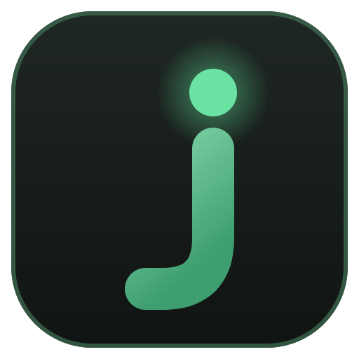

<p align="center"></p>

# Jayth

Aplicación de escritorio para Windows que convierte **cualquier modelo de IA local** (formato GGUF) en un agente que
programa, crea archivos, ejecuta comandos y programas, usa la web y controla el ordenador. Todo ocurre en tu equipo
y **tú apruebas cada acción**.

- **Cualquier modelo:** descarga GGUF de Hugging Face desde la propia app (lista las cuantizaciones y marca cuáles caben
  en tu equipo), usa un `.gguf` que ya tengas, o conéctate a un servidor compatible con OpenAI (Ollama, LM Studio, otro PC).
- **Se adapta al hardware:** detecta RAM, CPU y GPU NVIDIA; descarga la compilación oficial de llama.cpp adecuada
  (CPU, CUDA o Vulkan) y recomienda la cuantización.
- **Sin nube:** después de descargar el modelo funciona sin internet. Las herramientas web solo se usan si hay conexión.
- **Control total:** modos de permiso, botones Permitir/Denegar por acción, botón Detener y failsafe del ratón.
- **Dos modos:** Chat para cualquier tarea y **Jayth Code** para proyectos (árbol de archivos, editor, terminal y agente).
- **Siempre al día:** avisa de versiones nuevas de Jayth (y se actualiza con un clic) y de versiones nuevas de tus modelos.
- **Comentarios:** informa de errores o sugiere mejoras desde la app; revisas el texto antes de enviarlo.

## Instalación

**Opción 1: una línea** (PowerShell, sin permisos de administrador):

```powershell
irm https://raw.githubusercontent.com/Json-Tuiran/jayth.ai/main/install.ps1 | iex
```

**Opción 2: desde una copia local:** descarga o clona el repositorio y haz doble clic en `install.bat`.

El instalador:

1. Busca Python 3.10+ (64 bits) y, si no hay, lo instala para tu usuario.
2. Crea un entorno aislado (`.venv`) con la única dependencia, PySide6.
3. Crea accesos directos en el Escritorio y el menú Inicio, y abre la app.

En el primer arranque, un **asistente** detecta tu hardware, descarga el motor y el modelo (con reanudación y
verificación SHA-256) y deja todo configurado.

## Uso

| Parte | Para qué |
|---|---|
| Conversaciones (panel izquierdo) | Historial guardado; clic derecho para renombrar o borrar |
| Modelo | Encender/apagar el motor; **Modelos…** para añadir, cambiar o borrar modelos |
| Permisos | Solo lectura · Preguntar (por defecto) · Editar archivos · Automático |
| Chat | Cada acción aparece como tarjeta con su comando o cambio exacto, y su resultado |

**Modos de permiso:** las acciones delicadas (borrar, instalar, tocar el sistema o rutas de Windows) **siempre** piden
confirmación, incluso en modo Automático. Para abortar el control del ratón al instante, lleva el cursor a la esquina
superior izquierda de la pantalla.

## Herramientas del agente

Archivos (leer, escribir, editar, listar, buscar) · PowerShell y scripts · abrir programas/archivos/URLs · web (buscar,
leer páginas, descargar) · control del PC (capturas, clic, teclado, ventanas).

La búsqueda web usa DuckDuckGo. Si este pide un captcha, la app no lo salta y cae a Wikipedia. Para una búsqueda web
completa añade una clave de Brave Search en Ajustes.

## Dónde se guarda todo

| Qué | Dónde |
|---|---|
| Ajustes, conversaciones, motor, modelos | `%LOCALAPPDATA%\Jayth` (la carpeta de modelos se puede cambiar) |
| Carpeta de trabajo del agente | `Documentos\Jayth` (configurable) |
| **Modo portátil** (USB) | Crea un archivo vacío `portable.txt` junto a `app.py`: todo se guarda en `userdata\` |

## Desinstalar

Ejecuta `uninstall.ps1`. Quita los accesos directos y el entorno, y pregunta antes de borrar tus datos y modelos.

## Requisitos

Windows 10/11 de 64 bits. La memoria necesaria depende del modelo: el asistente indica qué cuantizaciones caben.
Con GPU NVIDIA el modelo se reparte automáticamente entre la VRAM y la RAM.

## Estructura

```
app.py                  entrada de la app de escritorio
server.py               interfaz web opcional (python server.py --open)
jayth/
  desktop.py            ventana principal
  wizard.py             asistente, gestor de modelos y ajustes
  agent.py              bucle del agente (API compatible con OpenAI)
  tools.py              herramientas
  core.py               ajustes, conversaciones y proceso del motor
  provision.py          descargas (llama.cpp y Hugging Face)
  hardware.py           detección de hardware y recomendaciones
  paths.py / theme.py   rutas y tema
assets/                 icono e iconos de la interfaz
install.ps1 / .bat      instalador · uninstall.ps1
```
